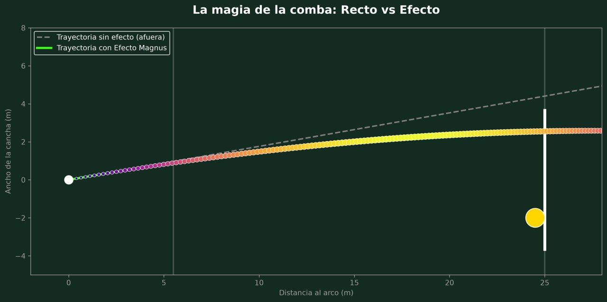

# MN-ErielMichel
Simulación de la trayectoria de un tiro libre usando EDOs y Runge-Kutta en Python.

## 🧮 Matemática Numérica
El movimiento del balón se modela usando un sistema de Ecuaciones Diferenciales Ordinarias (EDOs) no lineales. Para resolverlo, se utiliza el método de Runge-Kutta de cuarto orden (RK45) mediante scipy.integrate.solve_ivp.

Se modelan tres fuerzas principales:
1. Gravedad
2. Arrastre (Drag)
3. Efecto Magnus (Fuerza perpendicular generada por el giro del balón).

## 📊 Resultados
El script compara una trayectoria sin giro (línea recta que se va afuera) contra una con giro (que se dobla hacia el arco).

## 🚀 Cómo ejecutarlo
1. Instala las dependencias:
   `bash
   pip install -r requirements.txt

